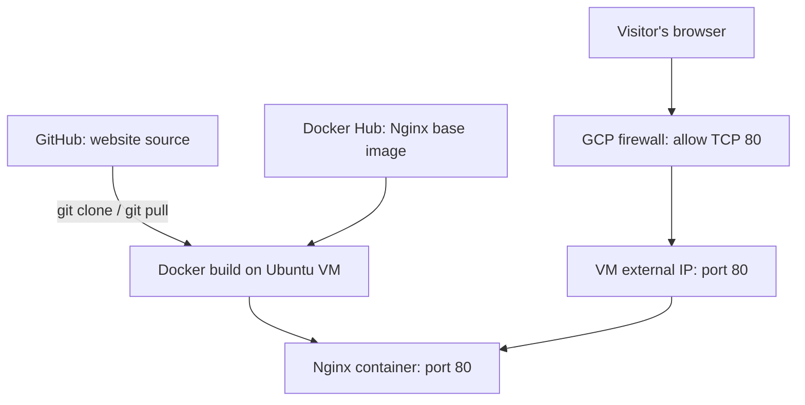

# Avinash’s Project Notes — Avitechno Cloud Launchpad

**Google Cloud Compute Engine + Ubuntu + Docker + Nginx**  
Prepared for Avinash Kumar Singh | AVITECHNO | 5 October 2026

## My project objective

I will deploy my own static website on a Google Cloud virtual machine, package it with Docker, serve it using Nginx, and learn how to verify and troubleshoot it. This is a guided learning project; completion is recorded only after I run the steps and collect evidence.

**Estimated lab time:** 60–90 minutes, excluding account setup. **Level:** beginner. **Outcome:** an HTTP website reachable at my VM’s external IP address.

This first version is a public HTTP demonstration with no passwords, forms or private data. HTTPS, a domain, redundancy and automated delivery are later upgrades. A single VM is not highly available.

## 1. Understand the design

GitHub stores my code. Docker builds an image from the Dockerfile. Nginx runs **inside** the Docker container on the Ubuntu VM. Visitors connect to the VM’s external IP on TCP port 80. Docker maps host port 80 to container port 80.



The screenshot’s “Docker container pulls code” arrow is simplified here: **Git pulls source; Docker pulls a base image and builds the website image.** We do not install a second Nginx service on the host.

| Component | My easy explanation |
|---|---|
| Compute Engine VM | A rented virtual computer |
| Ubuntu | The VM’s operating system |
| VPC and subnet | The network containing the VM |
| Firewall rule | Controls which incoming connections are allowed |
| Dockerfile | Recipe for building my image |
| Docker image | Packaged website and Nginx |
| Container | A running instance of that image |
| Docker Compose | Starts and manages the service from a YAML file |
| Nginx | Responds to web requests with my site files |

## 2. Prepare accounts and cost controls

Use a personal learning project, not a production company project. You need a Google Cloud account with billing enabled and permission to create VMs, networks and firewall rules, plus a GitHub account. Open https://console.cloud.google.com/ and create/select a project named **Avitechno Cloud Lab**. Record its unique **project ID**, which is different from its display name.

Under Billing → Budgets & alerts, set a budget you are comfortable with and email thresholds. A budget alerts you; it does not automatically stop spending. VM runtime, disks, public IPv4 and network traffic can incur charges. Review the console estimate before creating resources; this guide does not promise a free deployment. Stop or delete resources after practice; stopped VMs can still leave billable resources.

## 3. Prepare my source code on Windows

Extract this ZIP into `F:\gen-AIlabs\avitechno-cloud-launchpad`. Open the folder in VS Code. Ensure this folder directly contains `Dockerfile`, `compose.yaml`, `nginx.conf`, `install-docker.sh`, `README.md`, and `site/index.html`.

Read `site/index.html` and customize the heading or learning objective. Do not add passwords, tokens, employer data or private contact details. Double-click the HTML file for a basic visual preview; the `/health` link only works when Nginx runs.

In GitHub, create an empty **public** repository called `avitechno-cloud-launchpad`. For this guide, do not initialize a README there. Upload the extracted project files using Add file → Upload files, preserve the `site` folder, and commit. The Dockerfile must be at the repository root, not inside an extra folder. This avoids needing Git credentials on the VM. Keep only public demo content in this repository.

Checkpoint: GitHub shows `Dockerfile` and `site/index.html` at the expected paths.

## 4. Open Google Cloud Shell

Click the Cloud Shell terminal icon at the top of the Google Cloud console and authorize it when prompted. Commands in steps 4–6 run in **Cloud Shell (Bash)**, not Windows PowerShell. Replace the project ID below with your real ID.

```bash
export PROJECT_ID="REPLACE_WITH_YOUR_PROJECT_ID"
export REGION="asia-south1"
export ZONE="asia-south1-a"
gcloud config set project "$PROJECT_ID"
gcloud config get-value project
gcloud services enable compute.googleapis.com iap.googleapis.com
```

Use a different region/zone if your organization, quota or pricing requires it. The commands assume a new dedicated lab and unused resource names. Run each block once and inspect errors before continuing.

## 5. Create my network and firewall rules — Cloud Shell

```bash
gcloud compute networks create avitechno-lab-vpc --subnet-mode=custom
gcloud compute networks subnets create avitechno-lab-subnet \
  --network=avitechno-lab-vpc --region="$REGION" --range=10.20.0.0/24
gcloud compute firewall-rules create avitechno-allow-http \
  --network=avitechno-lab-vpc --direction=INGRESS --allow=tcp:80 \
  --source-ranges=0.0.0.0/0 --target-tags=avitechno-web
gcloud compute firewall-rules create avitechno-allow-iap-ssh \
  --network=avitechno-lab-vpc --direction=INGRESS --allow=tcp:22 \
  --source-ranges=35.235.240.0/20 --target-tags=avitechno-ssh
```

HTTP is intentionally public for this lab. SSH is limited to Google’s IAP forwarding range rather than opened to the internet. The network tags select which VM receives these rules.

## 6. Create my Ubuntu VM and connect — Cloud Shell

```bash
gcloud compute instances create avitechno-web-vm \
  --zone="$ZONE" --machine-type=e2-micro \
  --subnet=avitechno-lab-subnet \
  --image-family=ubuntu-2404-lts-amd64 --image-project=ubuntu-os-cloud \
  --boot-disk-size=10GB --boot-disk-type=pd-balanced \
  --tags=avitechno-web,avitechno-ssh \
  --no-service-account --no-scopes
gcloud compute instances describe avitechno-web-vm --zone="$ZONE" \
  --format='get(networkInterfaces[0].accessConfigs[0].natIP)'
gcloud compute ssh avitechno-web-vm --zone="$ZONE" --tunnel-through-iap
```

Record the external IP. Accept SSH key creation if prompted. The VM needs outbound internet access to download GitHub code, Docker packages and images; its external IP provides this in the lab. No cloud API access is needed from the website, so no VM service account is attached.

IAP requires **IAP-Secured Tunnel User** (`roles/iap.tunnelResourceAccessor`) and appropriate Compute/SSH permissions. On a managed project, ask the administrator for access if denied. If OS Login is enforced, OS Login/OS Admin Login permissions may also be required. Do not solve an IAM error by opening SSH to the whole internet.

Checkpoint: the terminal prompt now shows you are connected to the Ubuntu VM. Run `hostname` and `cat /etc/os-release`.

## 7. Download my project — inside Ubuntu VM

Replace `YOUR_GITHUB_USERNAME` below. These are Linux commands, not PowerShell.

```bash
sudo apt-get update
sudo apt-get install -y git
git clone https://github.com/YOUR_GITHUB_USERNAME/avitechno-cloud-launchpad.git
cd avitechno-cloud-launchpad
ls -la
```

If clone fails, check spelling and confirm the repository is public. Check that `Dockerfile` is in the current folder.

## 8. Install Docker — inside Ubuntu VM

Read `install-docker.sh` first. It adds Docker’s official Ubuntu package repository, installs Docker Engine and Compose, starts Docker, and runs the hello-world check. Use it on this fresh VM only; do not apply it blindly to an existing Docker server.

```bash
sed -i 's/\r$//' install-docker.sh
bash install-docker.sh
sudo docker --version
sudo docker compose version
```

Checkpoint: the hello-world confirmation appears and both version commands work. We keep using `sudo`; membership in the Docker group gives powerful host access and is unnecessary for this lesson.

## 9. Build and run my website — inside Ubuntu VM

```bash
sudo docker compose config
sudo docker compose up -d --build
sudo docker compose ps
sudo docker compose exec website nginx -t
curl -i http://127.0.0.1/health
curl -I http://127.0.0.1/
```

Expected: Compose shows a running service, Nginx reports a successful configuration test, `/health` returns HTTP 200 with `healthy`, and the home page returns HTTP 200. The container health status may initially be `starting`; recheck after about 30 seconds.

`FROM` selects an Nginx base image; `COPY` adds the configuration and web files. `80:80` publishes the container port on the host. `restart: unless-stopped` restarts the service after a reboot unless you deliberately stopped it. The health check reports status; it does not automatically repair an unhealthy running container. The base tag `stable-alpine` changes over time; record the actual image ID and later pin a reviewed digest for reproducible deployments.

## 10. Open my website — Windows browser

Visit `http://YOUR_VM_EXTERNAL_IP` using the exact external IP from step 6. Use **http**, not https. You should see “Avitechno — My Cloud Launchpad” and your name. Visit `http://YOUR_VM_EXTERNAL_IP/health` too.

HTTP is deliberately sufficient for this public demo. Add a domain and valid TLS certificate before collecting any information or treating it as a production service. A browser’s “Not secure” label is expected for this HTTP lab.

## 11. Make my first update

In GitHub, edit `site/index.html`, add a sentence about your learning, and commit. Inside the VM’s project folder:

```bash
git pull --ff-only
sudo docker compose up -d --build
curl -I http://127.0.0.1/
```

Refresh the browser (Ctrl+F5). Because the files are copied into the image, a Git pull alone does not update the running website. Rebuilding and recreating the container applies the change. This is manual deployment; CI/CD is a later project phase.

## 12. Practice operations and collect evidence

Run inside the VM:

```bash
sudo docker compose logs --tail=50 website
sudo docker stats --no-stream
sudo docker compose images
git rev-parse HEAD
sudo docker compose restart website
curl -i http://127.0.0.1/health
```

Restarting briefly interrupts this single-container site. Logs show requests and errors; metrics show resource usage. For a recovery exercise, run `sudo docker compose stop`, confirm the site is unreachable, then run `sudo docker compose up -d` and confirm it returns.

Save screenshots of the VM details, healthy container, HTTP 200, website page, updated page and logs. Record date, commit ID, image ID, problem encountered, fix, and result. Remove account IDs, emails, credentials and sensitive terminal output before sharing publicly. Do not claim to have completed the lab until these checks pass.

## 13. Troubleshooting notes

| Symptom | Check and action |
|---|---|
| API or billing error | Verify selected project, enabled billing and Compute API; read the actual error |
| VM capacity/quota error | Check quota or choose another permitted zone and update `ZONE` consistently |
| SSH / IAP denied | Check the IAP role, SSH/OS Login permissions, VM tag and IAP firewall rule |
| Docker daemon unavailable | Run `sudo systemctl status docker` and `sudo systemctl start docker` |
| Docker permission denied | Use `sudo docker ...` as shown |
| Port 80 already allocated | Run `sudo ss -ltnp '( sport = :80 )'`; identify the service before changing it; do not run host Nginx and the container on the same port |
| Local curl fails | Inspect `sudo docker compose ps` and logs; run `nginx -t` inside the container |
| Local curl works, browser times out | Confirm external IP, public TCP 80 firewall, VM network tag and HTTP URL |
| Nginx default page | Confirm the repository paths, Dockerfile COPY, then rebuild the image |
| Page not updated | Confirm Git commit, rebuild, then hard-refresh the browser |
| Download/DNS failure | Test outbound networking and DNS; check organization network policies and registry availability |
| Disk fills up | Inspect `df -h` and `sudo docker system df`; remove only known unused images after review |

Docker-published ports can bypass UFW rules; this lab relies on the GCP VPC firewall for inbound control. Do not expose the Docker daemon’s TCP API.

## 14. Cleanup — return to Cloud Shell

First ensure your source changes are in GitHub and evidence is saved. Type `exit` to leave the VM. If Cloud Shell restarted, set the real `PROJECT_ID` and `ZONE` again, then verify `gcloud config get-value project`. The following commands delete only this lab’s named resources. Review each deletion prompt.

```bash
gcloud compute instances delete avitechno-web-vm --zone="$ZONE"
gcloud compute firewall-rules delete avitechno-allow-http avitechno-allow-iap-ssh
gcloud compute networks subnets delete avitechno-lab-subnet --region=asia-south1
gcloud compute networks delete avitechno-lab-vpc
gcloud compute disks list
gcloud compute addresses list
```

Adjust the subnet region if you used a different one. The boot disk is normally auto-deleted with this VM; verify no unwanted disk or reserved address remains. Do not delete unrelated resources. Review Billing later because usage reporting can lag. Stopping a container does not stop VM charges.

## 15. My explanation for an interview — use after successful completion

“I built Avitechno Cloud Launchpad, a static website hosted on an Ubuntu Compute Engine VM. I stored the source in GitHub, built a Docker image with Nginx, and exposed HTTP through a targeted VPC firewall rule. I verified service health, checked logs, deployed an update and practiced recovery and cleanup. I used IAP for SSH access. The next improvements are HTTPS, automated delivery and a more resilient architecture.”

Practice questions: Why use Docker? Why map port 80? How does an image differ from a container? What would you check if local curl works but the browser fails? What continues to cost money after a VM stops?

## Verification and references

The supplied files were checked for basic structure and shell syntax. No Google Cloud resources have been created for you, and the container was not executed in this preparation environment. Run the checkpoints above to validate your actual deployment.

Official references consulted:
- Docker Ubuntu installation: https://docs.docker.com/engine/install/ubuntu/
- Compute Engine VM creation flags: https://docs.cloud.google.com/sdk/gcloud/reference/compute/instances/create
- GCP firewall rules: https://docs.cloud.google.com/firewall/docs/using-firewalls
- IAP SSH access: https://docs.cloud.google.com/compute/docs/connect/ssh-using-iap

My completion checklist: [ ] code in GitHub [ ] VM created [ ] Docker installed [ ] website reachable [ ] health check passes [ ] update deployed [ ] logs reviewed [ ] recovery tested [ ] evidence captured [ ] resources cleaned up.
